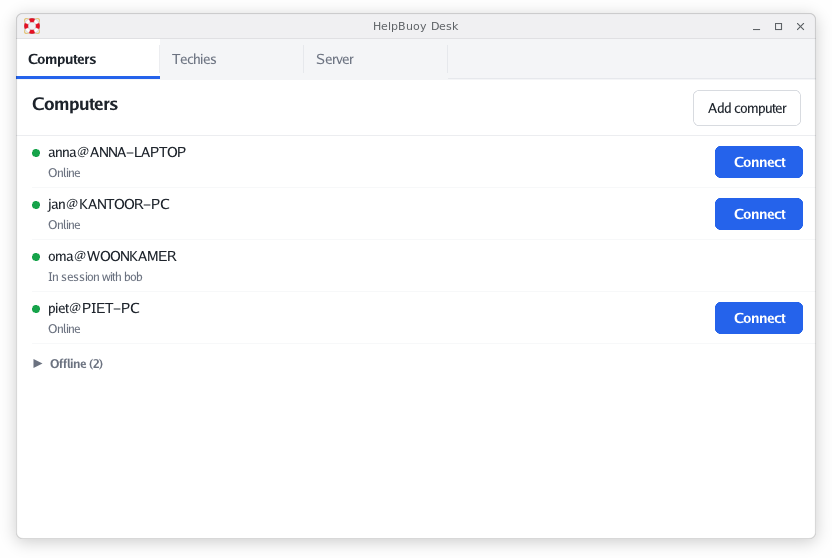
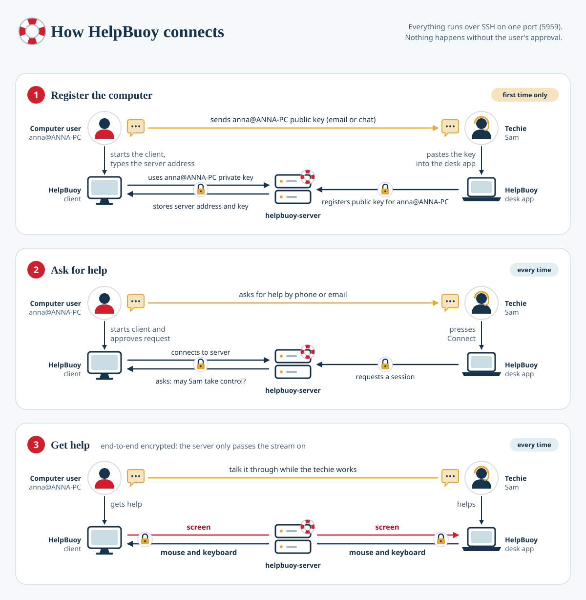

  
  <h1>HelpBuoy</h1>
  <a href="https://www.helpbuoy.com">HelpBuoy</a>: an alternative to TeamViewer QuickSupport and Microsoft Quick Assist.  
  
HelpBuoy is open-source remote support that you host yourself. A techie sees the screen of someone who asked for help and uses their mouse and keyboard, after that person allowed it. It runs on Windows, Linux and macOS.

  <a href="https://www.helpbuoy.com">Website</a> | <a href="https://www.helpbuoy.com/docs/getting-started/">Getting started</a> | <a href="https://www.helpbuoy.com/docs/">Documentation</a> | <a href="https://www.helpbuoy.com/download/">Download</a> | <a href="https://www.helpbuoy.com/video/">Video</a> | <a href="https://www.helpbuoy.com/support/">Support</a>

  
  

## What it does

- The person who needs help starts a small app and is asked before anyone takes control. Esc always takes control back.
- A session only carries the screen (computer to techie) and mouse and keyboard input (techie to computer). There is no shell, no file transfer and no unattended access.
- Everything runs over SSH inside a WebSocket over HTTPS, so it gets through networks that only allow web traffic. The server only connects the two sides and can't read a session.
- You run the server: as one Go binary, as a Debian package, or inside the desk app. Nothing depends on helpbuoy.com.
- A PC can be locked to its helpdesk, so a scam caller can't talk the user into connecting to another server.

## Quick start

1. Install the desk app on the techie's computer and the client on the computer that needs help, from the [download page](https://www.helpbuoy.com/download/) or the [latest release](https://github.com/HelpBuoy/HelpBuoy/releases/latest).
2. Start the desk app and connect with the address left empty. It then runs the server inside the app, on port 5959. Enter your company name and phone number on the Server tab.
3. Start the client on the other computer, type the address the desk app shows on its Server tab and send the key the client shows to the techie.
4. In the desk app, add the computer with that key and press Connect. The user allows it, and the session starts.

For a server that is always on, install `helpbuoy-server` from the same release; see [Running the server](#running-the-server). [Getting started](https://www.helpbuoy.com/docs/getting-started/) has the steps in more detail.

## What is in this repository

- `server/`: `helpbuoy-server`, a single Go binary that speaks SSH over a WebSocket over HTTPS, so it gets through networks that only allow web traffic. It authenticates keys and connects techies to computers. No shell, no file transfer, no forwarding. One server can host many helpdesks, each on its own path, like `relay.example.com/acme`.
- `desk/`: the cross-platform app the support techie uses. On Macs without Metal, such as virtual machines, it draws with Apple's software OpenGL renderer.
- `client-windows/`: the Windows app the person receiving help runs. It shows its public key to send to the techie, and asks for approval before anyone takes control.
- `client-linux/`: the same app for Linux. It is a single static binary for amd64 and arm64 that speaks the X11 protocol itself (with jezek/xgb), so it needs no libraries and runs on any X11 desktop. On a Wayland desktop (GNOME, KDE Plasma) it shares through the remote desktop portal, which asks the user which monitor to share, and reads the screen with GStreamer's `pipewiresrc` (packages `gstreamer1.0-pipewire` and `gstreamer1.0-tools`); without those it explains what to install. A local Esc ends the session but still reaches the focused application.
- `client-macos/`: the same app for macOS 12.3 and later, as one universal app for Intel and Apple silicon. It captures the screen with ScreenCaptureKit, or with CoreGraphics on Macs without Metal such as virtual machines, where a ScreenCaptureKit stream crashes WindowServer. It injects input with CGEvent, and draws the same window as the Linux client. On first start it asks for the Screen Recording and Accessibility permissions and opens the right page of System Settings.

See [PLAN.md](PLAN.md) for the design.

## Running the server

The apps connect to `wss://host/helpbuoy`, or to `wss://host/name` for a virtual host, and run SSH inside the WebSocket. An address typed without a port means 443. The pinned SSH host key identifies the server, not the TLS certificate, so the apps accept any certificate, including a self-signed one or that of a proxy that inspects TLS.

The server runs in one of three modes, chosen with `--mode`:

- `ssh` (the default): plain SSH without the WebSocket and TLS (direct connect), on `:5959`.
- `http`: plain HTTP on `127.0.0.1:5959`, behind a reverse proxy that serves HTTPS.
- `https`: the built-in HTTPS server, on `:443`.

`--listen` picks another address. The apps always try HTTPS first and fall back to plain SSH when that fails and the port answers with an SSH banner, so users type the same kind of address for every mode: `helpbuoy.example.com`, or `helpbuoy.example.com:5959` for a server in ssh mode.

In http mode (`--mode http`) the server runs behind a reverse proxy (nginx, Apache or HAProxy) that serves HTTPS and passes the path `/helpbuoy` on as a WebSocket, keeping the path and adding `X-Forwarded-For`. With virtual hosts every helpdesk has a path of its own, so the proxy passes everything on the host name on. [docs/proxy.md](docs/proxy.md) has configurations for all three, for several helpdesks behind one proxy, either as one process with virtual hosts or as separate processes.

Without a reverse proxy, `helpbuoy-server serve --mode https` serves HTTPS itself on `:443`, or on the port given with `--listen`. It takes a certificate with `--cert` and `--key` (loaded again when the files change), gets one from Let's Encrypt with `--acme --acme-host helpbuoy.example.com` (port 443 must be reachable from the internet), or makes a self-signed one. A server on another port is given out as `host:port`.

`helpbuoy-server serve --mode ssh` skips HTTP and TLS altogether: the apps speak SSH straight to the port. That is a little lighter and just as safe, since the pinned host key protects the connection in every mode, but it needs the port open in firewalls and doesn't pass HTTP proxies. Virtual hosts need http or https mode, since plain SSH has no path to name one. The desk app's own server always works this way, on port 5959.

### Virtual hosts

`helpbuoy-server serve --vhosts DIR` serves many helpdesks on one host name, address and port, each on its own path: users type `relay.helpbuoy.example.com/acme` or `relay.helpbuoy.example.com/beta` in the app, which opens its WebSocket on that same address. A browser that opens the address gets a line of text, which also serves as a check that the helpdesk runs. Every subdirectory of `DIR` with such a name (lower-case letters, digits and hyphens, not `helpbuoy`) is a normal state directory, with its own host key, techies, computers, company details and log. Techies of one virtual host never see the computers of another, and an address with an unknown name or without a name is refused. The host name plays no part, so adding a helpdesk needs no DNS, certificate or proxy change (see [docs/proxy.md](docs/proxy.md)). The server needs a host name of its own, since any path on it can be a helpdesk:

    helpbuoy-server vhost add acme --vhosts DIR
    helpbuoy-server info --vhost acme --vhosts DIR --company "Acme" --phone "+1 234 567 890"
    helpbuoy-server techie add --vhost acme --vhosts DIR alice 'ssh-ed25519 AAAA...'
    helpbuoy-server limit --vhost acme --vhosts DIR --sessions 1

`limit --sessions N` caps how many sessions a helpdesk has open at the same time, for all its techies together (0, the default, is no limit). Only the admin sets it; techies can't change it from the desk app.

`HELPBUOY_SERVER_VHOSTS=DIR` saves typing `--vhosts`. A running server starts a new virtual host within a second, and drops one within a second after its directory is deleted. With `--mode https --acme --acme-host relay.helpbuoy.example.com` the one certificate covers every virtual host.

`vhost stop NAME --stopped DIR2` moves a virtual host to `DIR2` (on the same file system, default `$HELPBUOY_SERVER_STOPPED`), `vhost start NAME` moves it back with its techies, computers and host key, and `vhost purge NAME` deletes a stopped one for good. `log --vhost NAME` prints the end of its `server.log`.

The Debian package also has an admin socket, `/run/helpbuoy-server-admin.sock`, for a web admin that runs as another user: members of the `helpbuoy-server-admin` group send one line with a JSON array of arguments and get `{"exit":N,"output":"..."}` back, without sudo. It runs `helpbuoy-server admin` as the server user, which only accepts admin commands on the directories of the service (`--state` is refused, `--vhosts` and `--stopped` must be the service's) (see `packaging/debian/README.Debian`).

## Scripts

- `./run.sh`: builds and starts a server, the desk app and the Windows client (in wine) on this machine for testing. All state lives in `.run/`; `./run.sh reset` clears it.
- `./screenshot.sh [page]`: makes or updates `screenshot.png`, the desk app in demo mode at 800x500, for this README. Uses `xvfb-run` when installed, otherwise a window shows briefly.
- `./release.sh [major|minor]`: bumps the version (build number by default), builds and tests everything, then tags, pushes and creates the GitHub release with the client and desk app MSIs, the client, desk app and server Debian packages (amd64 and arm64, the server also armhf for 32-bit Raspberry Pis) and the zipped macOS client and desk app. Last, it submits the MSIX packages to the Microsoft Store with `msstore/publish.sh`. The APT server adds the Debian packages to https://apt.helpbuoy.com/ by itself within ten minutes, see `../helpbuoy-apt`.

## The APT repository

Every Debian package adds the HelpBuoy APT repository at https://apt.helpbuoy.com/ when it is installed, so installing a .deb from the release once is enough to get updates with `apt upgrade`; unattended-upgrades installs them too, which restarts helpbuoy-server. The repository is signed with a GPG key whose public part is `packaging/debian/helpbuoy.asc`, which `make deb` needs. [docs/signing.md](docs/signing.md) describes the repository, the release steps, and how to make, back up and change the key.

## The Microsoft Store

The Windows client and the desk app are also in the Microsoft Store (Store IDs 9NZXVS50R8VB and 9NM475B9T4BC), as full-trust MSIX packages of the same exes, so they install without a SmartScreen warning. Once they are live, winget installs them from the Store as well: `winget install 9NZXVS50R8VB` for the client and `winget install 9NM475B9T4BC` for the desk app. The Store versions have no "Check for updates" link, since the Store updates them.

`make msix` builds the unsigned packages in `bin/` from `installer/*.appxmanifest.xml`, packed by `tools/mkmsix` because makeappx only runs on Windows. `msstore/publish.sh` submits them for each release, and `release.sh` runs it; the Store signs them. To try a package before it is in the Store, `make msix-test` signs a copy of each with a self-signed test certificate: import `bin/msix-test.cer` on the test PC into Local Machine, Trusted People, then open a `_test.msix`. The listings, screenshots and logos are in `msstore/`, see [msstore/README.md](msstore/README.md).

## Building the macOS apps

Everything else builds with only Go, including the macOS desk app and the Linux packages for amd64 and arm64, but the macOS client needs cgo for ScreenCaptureKit and AppKit. It is cross compiled on Linux with zig against the macOS 12.3 SDK:

    mkdir -p ~/SDKs && cd ~/SDKs
    curl -LO https://github.com/joseluisq/macosx-sdks/releases/download/12.3/MacOSX12.3.sdk.tar.xz
    tar xf MacOSX12.3.sdk.tar.xz

Install zig 0.16 (on the PATH, or in `~/SDKs/zig-0.16.0/`). Then `make zip-macos` writes `dist/helpbuoy_<version>_macos.zip` and `dist/helpbuoy-desk_<version>_macos.zip`. `MACOSX_SDK` and `ZIG` override the locations.

The apps are not signed or notarized (#5). zig and the Go linker sign the Apple silicon part of each binary ad hoc, which is enough to run it, but macOS still blocks the apps the first time. The person who needs help unzips HelpBuoy, moves it to Applications and opens it once. When macOS says it can't check the app, they open System Settings, Privacy & Security, scroll down and click Open Anyway next to HelpBuoy. The desk app works the same way. From a terminal, `xattr -dr com.apple.quarantine /Applications/HelpBuoy.app` does the same. After every update macOS asks for the Screen Recording and Accessibility permissions again, because the app has no stable signature.

## Alternatives

Open source TeamViewer alternatives on GitHub, ranked by stars (November 2026). Descriptions are taken from GitHub (translated to English where needed).

| Project | Stars | Description | License |
| --- | ---: | --- | --- |
| [rustdesk/rustdesk](https://github.com/rustdesk/rustdesk) | 128,133 | An open-source remote desktop application designed for self-hosting, as an alternative to TeamViewer. | AGPL-3.0 |
| [galaxy-s10/billd-desk](https://github.com/galaxy-s10/billd-desk) | 9,146 | Remote desktop control and game streaming built with Vue3, WebRTC, Node.js and Flutter | MIT |
| [Ylianst/MeshCentral](https://github.com/Ylianst/MeshCentral) | 7,614 | A complete web-based remote monitoring and management web site. Once setup you can install agents and perform remote desktop session to devices on the local network or over the Internet. | Apache-2.0 |
| [immense/Remotely](https://github.com/immense/Remotely) | 5,093 | A remote control and remote scripting solution, built with .NET 8, Blazor, and SignalR. | GPL-3.0 |
| [kunkundi/crossdesk](https://github.com/kunkundi/crossdesk) | 4,688 | A lightweight, cross-platform remote desktop software with support for Web Client access | GPL-3.0 |
| [miroslavpejic85/p2p](https://github.com/miroslavpejic85/p2p) | 4,086 | 🖥️ P2P Remote Desktop - Portable peer-to-peer remote desktop with no installation required. | MIT |
| [DarkCoderSc/PowerRemoteDesktop](https://github.com/DarkCoderSc/PowerRemoteDesktop) | 2,247 | Remote Desktop entirely coded in PowerShell. | Apache-2.0 |
| [dchapyshev/aspia](https://github.com/dchapyshev/aspia) | 1,966 | Remote desktop and file transfer tool. | GPL-3.0 |
| [ultravnc/UltraVNC](https://github.com/ultravnc/UltraVNC) | 1,526 | 👁️ UltraVNC Server, UltraVNC Viewer, UltraVNC Repeater and UltraVNC SC \| Official repository: https://github.com/ultravnc/UltraVNC | GPL-3.0 |
| [zibo-chen/SubnetDesk](https://github.com/zibo-chen/SubnetDesk) | 741 | LAN-only remote desktop based on RustDesk | AGPL-3.0 |
| [barry-ran/QuickDesk](https://github.com/barry-ran/QuickDesk) | 553 | QuickDesk is the first AI-native remote desktop — an open-source, free application with a built-in MCP (Model Context Protocol) Server that lets any AI agent see and control remote computers. | MIT |
| [DarkCoderSc/Arcane](https://github.com/DarkCoderSc/Arcane) | 335 | Arcane - A secure remote desktop application for Windows with the particularity of having a server entirely written in PowerShell and a cross-platform client (Python/QT6). | Apache-2.0 |
| [morrolinux/ChimeraDesk](https://github.com/morrolinux/ChimeraDesk) | 301 | Simple, fast and flexible DIY Remote Desktop software | GPL-2.0 |
| [bitbound/ControlR](https://github.com/bitbound/ControlR) | 266 | Open-source, self-hostable remote control and remote access. | MIT |
| [cea-sec/sanzu](https://github.com/cea-sec/sanzu) | 204 | Graphical remote desktop solution | GPL-3.0 |
| [RetGal/Dayon](https://github.com/RetGal/Dayon) | 175 | Dayon! - A cross-platform remote desktop assistance solution for your family and friends | GPL-3.0 |
| [DeskX11/DeskX](https://github.com/DeskX11/DeskX) | 161 | Universal light and fast program for remote control of a computer. | Apache-2.0 |
| [mmozeiko/ScreenBuddy](https://github.com/mmozeiko/ScreenBuddy) | 152 | Simple remote desktop sharing application for Windows | Unlicense |

---

[www.helpbuoy.com](https://www.helpbuoy.com)

